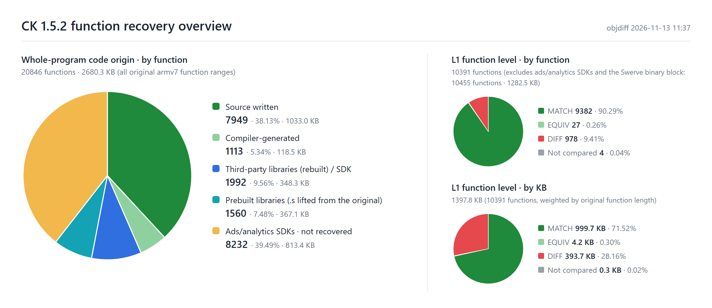

# Contract Killer Reverse

**English** | [中文](README_CN.md)

## Overview

This project is based on `BountyHunter`, the main executable of Glu Mobile's *Contract Killer* for iOS, version 1.5.2. The original is a fat armv6 + armv7 file; this project **recovers the armv7 slice only**.

The armv7 slice is not stripped and keeps its full STABS debug map: the source path, object name and function ownership of all 763 compile units, plus the original link order. The source tree, file split and function order follow that map.

The goal is a **1:1 source recovery**: compiling the recovered source with the original toolchain should give a `BountyHunter` that is byte-identical to the original armv7 slice. Fixing the game's own bugs is out of scope; original behavior, bugs included, is kept as is.

Only a highly trustworthy source makes later fixes and ports worth doing.

## Compiler, SDK and third-party libraries

The original binary does not record its compiler version. The versions below are backed by per-function machine-code comparison, the build path in the debug map, and version strings inside the binary. The toolchain was determined on CKZ first and then checked on CK: Lua, TinyXML and other objects built with it match the CK original byte for byte in the vast majority of functions.

> ✅ aligned　⚠️ same version, one point cannot be fully verified　❓ original version unknown

### Toolchain

| Component | Original | This project | Aligned | Notes |
| --- | --- | --- | :---: | --- |
| Compiler | Apple clang 3.0 | clang-211.12 (shipped with Xcode 4.2.1 4D502) | ⚠️ | Determined from code-generation traits (see CKZ); CK's own code and third-party libraries align with this version as well |
| Assembler | cctools as | cctools-809 (the external `as` of the same Xcode; clang with `-no-integrated-as`) | ⚠️ | Determined from encodings: low-register `add` inside IT blocks is T1 in the original, while clang's integrated assembler only emits T2 |
| Linker | ld64 | ld64-127.2 (same Xcode) | ⚠️ | The original targets iOS 3.0 and uses the old LINKEDIT layout (`__DATA,__dyld` section, `crt1.o` entry); the dylib list and order come from the original; the whole file is not byte-identical yet |
| iOS SDK | — | iPhoneOS 5.0 SDK (same Xcode) | ⚠️ | `-miphoneos-version-min=3.0`; the sdk field of the original `LC_VERSION_MIN` is 0, so the binary cannot confirm it |
| Flags | — | `-Os -g -fno-strict-aliasing -fvisibility=hidden`<br>C++: `-fno-rtti -fno-exceptions`<br>Objective-C++: `-fno-rtti` | ✅ | Inferred from byte-identical functions; all original Glu symbols are private extern, which proves `-fvisibility=hidden` |
| Build path | `/Applications/buildAgent/work/1365410bc639d1a3/` | same (bind mount) | ✅ | `__FILE__` strings and the compile directory in the debug info match the original |

Xcode 4.2.1's clang, as and ld are x86_64 Mach-O programs. This project runs them directly on Linux through [maloader](https://github.com/shinh/maloader) with three patches, see `toolchain/patches/maloader.patch`.

### Third-party libraries

"Functions" is the per-function comparison against the original (identical / different).

| Library | Version | Source | Functions | Notes |
| --- | --- | --- | --- | --- |
| Lua | 5.1.4 | upstream + Glu changes | 466 / 10 | Compiled as C++ |
| LuaBridge | 0.2 | upstream + Glu changes | 4 / 1 | CK still uses 0.2's `indexer` / `newindexer` (CKZ moved to `__index`) |
| TinyXML | 2.5 | upstream | 114 / 0 | |
| libjpeg | 6b | upstream + Glu changes | 152 / 0 | |
| libpng | 1.2.41 | upstream + Glu changes | 97 / 8 | |
| libogg | 1.1.3 | upstream | 28 / 1 | |
| libvorbis | 1.2.0 | upstream + Glu private changes | 133 / 0 | |
| zlib (inflate) | 1.2.3 | upstream | 12 / 0 | Only the inflate part is in the original |
| Facebook iOS SDK (FBConnect) | ❓ | upstream | 158 / 1 | |
| ASIHTTPRequest | ❓ | upstream | 138 / 1 | |
| Reachability | ❓ | Apple sample code + Glu private changes | 12 / 0 | |
| Swerve engine core | — | **assembly lifted from the original binary** | byte-identical | A prebuilt library without symbols in the original (380,452 bytes), see below |
| Tapjoy | 8.1.5 | recovered from machine code | 166 / 266 | Built from source inside the Glu project; another 124 functions not compared |
| PlayHaven | 2.9.0 | recovered from machine code | 81 / 130 | Same; another 48 functions not compared |
| AdColony, Flurry, AdMarvel, AdMob | — | not recovered | — | Internal code of these ad/analytics SDKs is not recovered. AdColony, Flurry and AdMarvel each have a replacement layer that is **not original code**, switched by `CK_ADS_COMPAT` (off by default, taking the original failure callbacks); see `CK_source/stubs/ads/` |

The Swerve engine core is a prebuilt static library in the original. It is kept as assembly source in `CK_source/packages/swerve/code/cocoa/libs/swerve_core.s` and is byte-identical to the original after relocation to the original addresses.

Glu's own ad integration layer (`AdManager`, `TapjoyManager`, `CPHManager` and others) is Glu code and counts toward the results below.

## Results



All code except the ad SDKs has been written; 90.29% of the functions are identical to the original. Counted in bytes, 71.52% of the bytes are identical.

Two more levels are verified:

- **Data**: of the 1,751 data symbols outside the ad SDKs (constants, vtables, ObjC metadata and so on), none differ; 94.97% are byte-identical and the rest have unverifiable tails or names the original lacks.
- **Link**: of the 11,219 source functions in the linked binary, 2,789 have the original's raw bytes, and another 6,774 differ only in addresses and match after normalization.

Per-function status: [function table](docs/function-table.en.html).

## Rebuild

The build runs on Linux. On Windows the scripts create a dedicated WSL distro under this repository's `.wsl\` directory; it does not use drive C and does not touch existing WSL distros.

### Requirements

| Item | Requirement |
| --- | --- |
| System | Windows 10 / 11 (x64) with WSL 2, or x86_64 Ubuntu 24.04 |
| WSL | If missing, run `wsl --install --no-distribution` in an administrator PowerShell and reboot |
| Xcode 4.2.1 | **Bring your own**: `installxcode_421_lion.dmg` (4D502, 1.8 GB, SHA-256 `a9bb2633…a52ef835`); downloading needs an Apple ID, see below |
| Downloaded automatically | Ubuntu 24.04 WSL image, apt packages, maloader source |
| Disk | About 8 GB (the distro's virtual disk; it does not shrink after the dmg's temporary files are removed) |

To download Xcode 4.2.1, sign in to Apple Developer and open in the browser

```
https://developer.apple.com/services-account/download?path=/Developer_Tools/xcode_4.2.1_for_lion_21265/installxcode_421_lion.dmg
```

The More Downloads page itself loops through redirects, so use this address. Put the file in `toolchain\xcode\`. The scripts unpack only five component packages: `clang`, `iPhoneSDK5_0`, and `iPhoneHostSideTools`, `iPhoneSDKTools`, `DeveloperToolsCLI`, which hold ld, as and the other tools.

### Steps (Windows)

1. **Set up** (once): double-click `setup.bat`. If the dmg is elsewhere, run `setup.bat <dmg path>` from a command line. The script:
   - downloads the Ubuntu 24.04 WSL image and imports it as the distro `ck-build` (disk under `.wsl\`);
   - installs the build dependencies, builds maloader at a fixed commit and applies the patches;
   - checks the dmg's SHA-256, unpacks the needed Xcode components, and finally runs clang and ld through maloader as a self-check.
2. **Build**: double-click `build.bat`. It compiles all 701 object files (only changed files are recompiled) and links `BountyHunter`. `build.bat -c` compiles without linking; `build.bat -B` recompiles everything.
3. The product is `_output\BountyHunter`, next to `BountyHunter.sha256`, the link arguments `link.args` and the link log `link.log`.

If you already have a WSL distro with this toolchain (for example the CKZ one), skip setup, set `CK_DISTRO=<distro name>` and run `build.bat`. The two projects do not collide: CK uses `/work/ck_src` and `/work/ck_build`, while Xcode and maloader are shared.

Object files are reproducible: a forced rebuild of the same source gives byte-identical copies of all 701 `.o` files. The hash of `BountyHunter` changes with every rebuild because ld64 writes each object's modification time into the debug map (N_OSO entries); everything else is byte-identical.

### Steps (Linux)

On x86_64 Ubuntu 24.04 the same scripts run directly:

```bash
sudo bash toolchain/setup_distro.sh /path/to/installxcode_421_lion.dmg
```

```bash
sudo bash toolchain/build.sh
```

The build uses `/work` and creates the original build paths under `/Applications/buildAgent/...` and `/Developer/...` (bind mounts and symlinks), so a dedicated VM or container is recommended.

### Running

You need a jailbroken armv7 iOS device. Replace the main executable `BountyHunter` of Contract Killer 1.5.2 with the product. The product contains only the armv7 slice and does not support armv6 devices. Played on an iPad with iOS 6.1.3.

## Layout

| Path | Contents |
| --- | --- |
| `CK_source/` | Recovered source, mirroring the original build machine's root; relative paths under `packages/` and `src/` match the original |
| `CK_source/stubs/ads/` | Switch `CKAdsCompat.h` and notes for the ad/analytics replacement layer (the layer is not original code) |
| `toolchain/` | Setup and build scripts, maloader patch, original link order `link_order.txt` |
| `docs/` | Function table and overview charts |
| `setup.bat` / `build.bat` | One-click entry points for Windows |

## Disclaimer

- This project is not affiliated with, authorized or endorsed by Glu Mobile or its affiliates.
- The Contract Killer names, trademarks, art, audio, levels and other game content, as well as the original program, belong to their respective owners.
- This repository contains recovered source, build scripts and **the Swerve engine core assembly generated from the original binary**. It contains no original executable, game data or Xcode. You need a legally obtained copy of the game to run it.
- This project is for study, research and preservation only, not for commercial use.
- The code is provided "as is", without warranty of any kind; use at your own risk.
