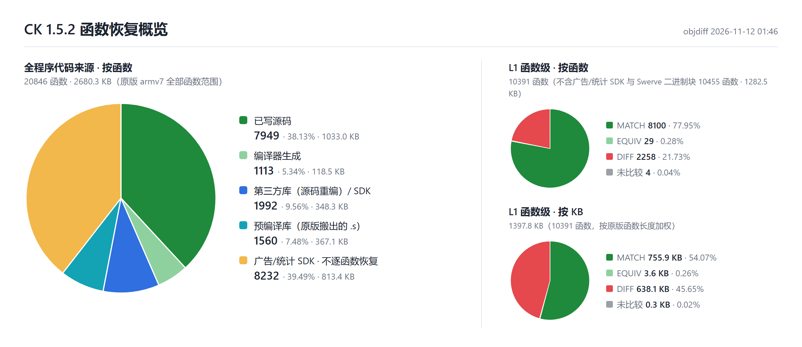

# Contract Killer Reverse

[English](README.md) | **中文**

## 概述

本项目基于 Glu Mobile《Contract Killer》iOS 1.5.2 版本的主程序 `BountyHunter`。原版是 armv6 + armv7 的 fat 文件，本项目**只还原 armv7 切片**。

armv7 切片没有剥离符号，还保留了完整的 STABS 调试映射：763 个编译单元的源文件路径、目标文件名、每个函数的归属和原版链接顺序都有据可查。源码目录结构、文件划分和函数顺序都按这份映射还原。

目标是 **1:1 还原源码**：用原版工具链编译恢复出的源码，得到与原版 armv7 切片逐字节一致的 `BountyHunter`。原版行为（包括原版自身的 bug）一律按原样保留。

姊妹项目 [Contract Killer: Zombies Reverse](https://github.com/Feiyang0102sso/contract-killer-zombie-re) 用的是同一支 Glu 引擎和同一套工具链，两个仓库互相独立。

> 已能用原版工具链正式链接 armv7 候选程序。玩法、界面和逐函数校验仍在推进。

## 编译器、SDK 与第三方库

工具链与 CKZ 相同。判定依据：CKZ 用这套工具链编出的 Lua、TinyXML 等目标文件，拿来直接对比 CK 原版，大部分函数逐字节一致。

| 组件 | 本项目 | 备注 |
| --- | --- | --- |
| 编译器 | clang-211.12（Xcode 4.2.1 4D502 自带） | 与 CKZ 相同 |
| 汇编器 | cctools-809（同一 Xcode 的外部 `as`，clang 加 `-no-integrated-as`） | 与 CKZ 相同 |
| 链接器 | ld64-127.2（同一 Xcode） | 原版最低系统版本是 iOS 3.0，用的是老式 LINKEDIT（`crt1.o`、`__dyld` 节） |
| iOS SDK | iPhoneOS 5.0 SDK（同一 Xcode） | `-miphoneos-version-min=3.0` |
| 编译参数 | `-Os -g -fno-strict-aliasing -fvisibility=hidden`<br>C++：`-fno-rtti -fno-exceptions`<br>Objective-C++：`-fno-rtti` | 与 CKZ 相同 |
| 构建路径 | `/Applications/buildAgent/work/1365410bc639d1a3/`（bind mount） | 与原版调试映射一致 |

Xcode 4.2.1 的 clang、as 和 ld 是 x86_64 Mach-O 程序，用打了补丁的 [maloader](https://github.com/shinh/maloader) 在 Linux 上运行，补丁见 `toolchain/patches/maloader.patch`。

已放入的第三方库：Lua 5.1.4（Glu 定制）、TinyXML 2.5、libjpeg 6b、libpng 1.2.41、libogg 1.1.3、libvorbis 1.2.0、zlib 1.2.3（inflate）、Facebook iOS SDK（FBConnect）。

## 当前进度



| 内容 | 状态 |
| --- | --- |
| 已恢复的源码 | 自家玩法、引擎和广告接入层均已编译出对应函数。正式链接纳入 699 个目标文件，含 Swerve 引擎核心汇编 |
| 逐函数校验 | 函数表记录按原版地址去重的对象级归一化比较，以及已独立复核的汇编范围 |
| Swerve 引擎核心 | 原版是预编译库，从原版二进制搬成汇编（`packages/swerve/code/cocoa/libs/swerve_core.s`），按原地址重定位后 380,452 字节逐字节一致 |
| 从 CKZ 移植的部分 | 平台层，以及与 CK 原版机器码至少 20% 相同的 gServe、玩法单元；都去掉了命名空间，CApp、Window、2D 图形接口、资源管理器等已按 CK 改 |
| 链接 | `ld64` 成功生成 `_output/BountyHunter`。候选与原版的完整 armv7 文件仍有差异，真机运行待校验 |

每个函数的状态见 [函数表](docs/function-table.cn.html)。

## Rebuild

构建在 Linux 里进行。Windows 上由脚本自动创建一个专用的 WSL 发行版 `ck-build`，放在本仓库的 `.wsl\` 目录下，不占 C 盘。

### 环境要求

| 项目 | 要求 |
| --- | --- |
| 系统 | Windows 10 / 11（x64），已启用 WSL 2；或者 x86_64 的 Ubuntu 24.04 |
| Xcode 4.2.1 | **需要自备**：`installxcode_421_lion.dmg`（4D502，1.8 GB），放到 `toolchain\xcode\` 下 |
| 磁盘 | 约 8 GB |

Xcode 4.2.1 的下载方法：登录 Apple Developer 后，在浏览器中打开

```
https://developer.apple.com/services-account/download?path=/Developer_Tools/xcode_4.2.1_for_lion_21265/installxcode_421_lion.dmg
```

### 步骤（Windows）

1. **准备环境**（只需做一次）：双击 `setup.bat`，或运行 `setup.bat <dmg 路径>`。
2. **构建**：双击 `build.bat`。`build.bat -c` 只编译不链接，`build.bat -B` 全部重新编译。
3. 产物在 `_output\BountyHunter`。

已经有一个装好这套工具链的 WSL 发行版（比如构建 CKZ 用的那个）时，不用重新 setup，设置环境变量 `CK_DISTRO=<发行版名>` 后直接运行 `build.bat`。两个项目的目录互不冲突：CK 用 `/work/ck_src`、`/work/ck_build`，Xcode 和 maloader 两边共用。

### 步骤（Linux）

```bash
sudo bash toolchain/setup_distro.sh /path/to/installxcode_421_lion.dmg
```

```bash
sudo bash toolchain/build.sh
```

## 目录

| 路径 | 内容 |
| --- | --- |
| `CK_source/` | 恢复的源码，对应原版构建机根目录，`packages/`、`src/` 的相对路径与原版一致 |
| `toolchain/` | 环境搭建与构建脚本、maloader 补丁、原版链接顺序 `link_order.txt` |
| `setup.bat` / `build.bat` | Windows 一键入口 |

## 免责声明

- 本项目与 Glu Mobile 及其关联方没有任何关系，也未获得其授权或认可。
- Contract Killer 系列的名称、商标、美术、音频、关卡等游戏内容，以及原版程序，版权均归其权利人所有。
- 本仓库只包含恢复出的源码和构建脚本，不包含原版可执行文件、游戏数据文件和 Xcode。运行需要自备合法取得的游戏。
- 本项目仅用于学习、研究和保存目的，不得用于商业用途。
- 代码按“现状”提供，不提供任何形式的担保；使用风险自负。
